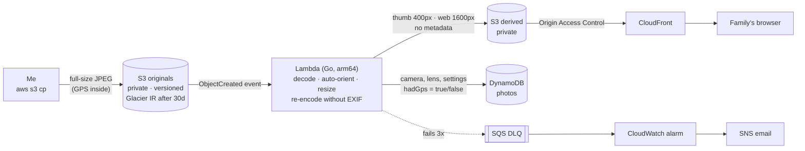

# wildlife-gallery


An event-driven photo pipeline for my wildlife and bird photography: drop a full-size JPEG into S3, and seconds later a web-size copy, with every bit of location data removed, is served from CloudFront.

## The problem

I photograph birds and wildlife and want to share the shots with family at web size, without handing them to a social platform. Camera JPEGs carry EXIF metadata, including GPS coordinates. For wildlife that's a real risk: a shared photo can reveal a nesting site, and photographers deliberately protect those. I wanted sharing where location leakage is impossible by design, not a setting I have to remember.

## Architecture



## Design decisions

| Decision | Chosen | Rejected | Why |
| --- | --- | --- | --- |
| Removing GPS | Re-encode pixels, so published files have **no EXIF at all** | Deleting just the GPS tags | Allow-nothing beats deny-some: no tag I forgot can leak |
| Keeping metadata | Camera, lens and settings stored in DynamoDB; only a `hadGps` flag for location | Storing coordinates privately | Data I never store can't leak later |
| Trigger loop safety | Separate originals and derived buckets | One bucket with prefixes | The function cannot write where it is triggered, so it can never invoke itself |
| Duplicate events | Deterministic photo ID (hash of bucket + key) | Random IDs | S3 delivers events at least once; a duplicate overwrites instead of duplicating |
| Failures | Async retries (2), then SQS DLQ + alarm | Logging only | A failed photo becomes an email, not a silent gap |
| Runtime | Go on `provided.al2023`, arm64 | Python + Pillow | Single static binary, fast cold start, Graviton is ~20% cheaper |
| Originals storage | Glacier Instant Retrieval after 30 days | Standard forever, or Deep Archive | Much cheaper than Standard and still millisecond reads if a photo needs reprocessing (90-day minimum storage charge) |
| Delivery | CloudFront + OAC on a private bucket | Public bucket / S3 website | Bucket stays fully private; HTTPS and edge caching for free tier-sized traffic |

## Cost

Measured target: **under 1 USD/month** for a few thousand photos. Lambda, DynamoDB, SQS and CloudFront all sit inside free tier or cost cents at this scale; the main cost is S3 storage of the originals.

_Actual numbers from Cost Explorer go here after a month of use._

## Security

- Both buckets block all public access and deny non-TLS requests. Only CloudFront (via OAC, scoped to this distribution's ARN) can read derived images.
- The Lambda role can read originals, write `photos/*` in the derived bucket, put items in one table, write its own logs and send to its own DLQ. Nothing else.
- Deployments use GitHub OIDC roles from [aws-portfolio-bootstrap](https://github.com/praveenbhatk8s/aws-portfolio-bootstrap): read-only for pull requests, apply only after approval in the `aws-portfolio` environment.

## Run it

Prerequisites: Go 1.24+, Terraform ≥ 1.10, AWS CLI v2 with SSO profile `portfolio`, `zip`.

```bash
aws sso login
cp infra/terraform.tfvars.example infra/terraform.tfvars   # set alert_email
make init
make plan        # runs the Go tests, builds the arm64 Lambda, plans
make apply
# confirm the SNS subscription email AWS sends you
```

Try it:

```bash
make upload FILE=~/Pictures/kingfisher.jpg ALBUM=2026-10-thueringer-wald
make logs        # watch it process (Ctrl+C to stop)
make photos      # the DynamoDB items
open "https://$(terraform -chdir=infra output -raw cdn_domain)/photos/<photoId>/web.jpg"
```

Prove the location is gone:

```bash
curl -s "https://<cdn_domain>/photos/<photoId>/web.jpg" -o web.jpg
exiftool web.jpg | grep -i gps    # prints nothing
```

Tear down (deletes the photos in S3 too; keep your local copies):

```bash
make destroy
```

## Roadmap

- [x] Phase 1: pipeline (S3 → Lambda → derived + DynamoDB), CloudFront, DLQ alarm
- [ ] Phase 2: gallery web page on the same distribution, albums from the `byAlbum` index
- [ ] Phase 3: browser uploads via presigned URLs behind a small API
- [ ] Stretch: Rekognition labels ("Bird", species guesses) with an honest accuracy note

## What went wrong

_Real errors and fixes, written as they happen._
